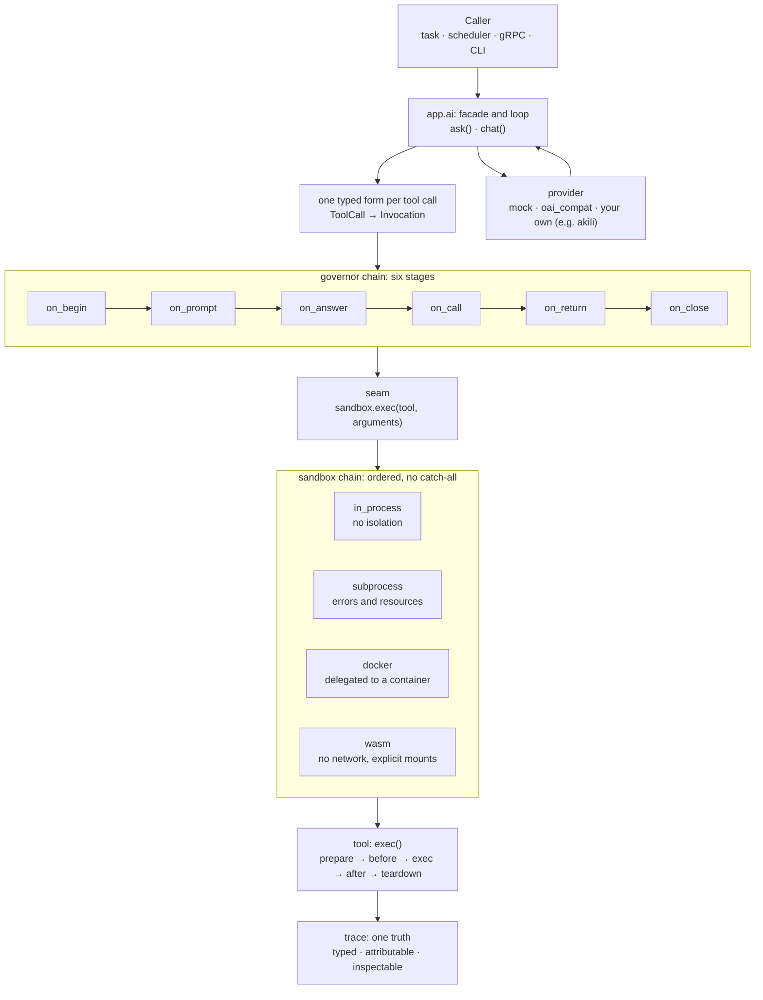

# Fundi: mission, value and scope

The position paper of tokeo-fundi, for a reader who wants to place the project
technically. It describes what fundi is for, how it is built, what it does on
purpose not do, and where it goes. Numbers that age with every commit are only
in section 11.

---

## 1 The mission in one sentence

**The model plans, the pipeline governs, the tools compute.**

No step is implicit, every step can be inspected. Fundi is the AI runtime for
the Tokeo framework and builds this sentence into its architecture: typed
contracts instead of provider SDKs, a chain of governed stages between the
model and the system, sandboxes that contain the execution, and a trace that
records every decision with the one who made it.

The names carry the division of roles: **fundi** (the master) is the agent that
wields the tools; **akili** (the mind) is the model that plans; **tokeo** (the
result) is what comes out of it.

---

## 2 The problem fundi answers

The usual ways of wiring an application to an LLM let the model reach straight
into the system. Three gaps follow, which fundi treats as a task of the
architecture and not as a detail of configuration:

**Governance depends on the provider.** Fundi turns every tool call into one
typed form (```ToolCall```, then ```Invocation```) **before** the governor chain
runs. A rule therefore applies the same way to every provider and every model.

**Permitting and containing get mixed up.** A policy decision ("this tool may
run") and an isolation boundary ("it runs behind this wall") are different
things with different guarantees. Fundi keeps them apart: a *governor* decides,
a *sandbox* contains, and no governor ever runs inside a sandbox.

**Security promises cannot be checked.** Whoever offers ```max_memory_mb``` and
cannot enforce it on the target platform sells theatre. On current macOS the
kernel refuses realistic memory limits for a fresh interpreter; fundi then fails
the call with "memory limit (max_memory_mb) is not enforceable on this platform"
instead of letting it run unlimited. The documentation says it plainly:
```in_process``` is no isolation, ```subprocess``` separates errors and
resources but is no jail, real isolation needs the docker or the WebAssembly
sandbox.

---

## 3 Positioning

Fundi does not compete with agents you install and talk to. It is the component
for agents you build into your own service and whose behaviour you must be
able to show. Where an operated agent exercises control through its product,
up to a model that judges flagged commands, in fundi the control is configured,
deterministic and attributable on the trace.

| Axis | The choice |
|---|---|
| Task of the AI | **Orchestration** of existing functions and modules in their fitting variant, not free generation. |
| Promise | **Deterministic enforcement, traceable runs**: the model stays free, the rules do not. Results are reproducible as far as the model allows, and the trace shows every source of variation. |
| Operation | Local where you want it: one OpenAI-compatible transport serves Ollama, llama.cpp, vLLM and MLX as well as any commercial API. The mock and akili run with no server at all. |
| Mark | **The trace: complete and attributable.** Who changed what, who denied, and why. |
| Second use | The runtime is also a **teaching reference** for how an agent and an LLM really work. |

The first line is easy to read past: fundi does not bet on models generating
code, but on models chaining existing, tested functions in the fitting
variant. That moves the question of quality from "was the generation good?"
to "was the composition permitted, contained and recorded?", and that question
can be answered.

**Code of the model is a plan like any tool call.** Where generation cannot be
avoided (CodeAct), fundi itself still generates nothing: the governors see the
code before it runs, the WebAssembly sandbox runs it behind the hardest wall
(no network, explicit mounts, hard limits), and the host, not the guest, records
what happened.

**The real entry point is programmatic.** The commands ```ai ask``` and
```ai chat``` are a visual check. The intended use is a task, a scheduler job or
a gRPC handler that calls ```app.ai.ask(prompt, agent='guarded')``` or
```app.ai.chat(...)``` and works with the result. There is always an agent:
without one named by the call, the profile or ```defaults.agent```, the run gets
the implicit agent, which offers no tools and no governors. A plain question
gets an answer, nothing can be called, and the trace shows it.

**The first users** are applications generated from the ramani template with the
AI branch, and existing tokeo applications that load ```tokeo.ext.ai```.

---

## 4 The architecture



### 4.1 Contracts as the product

Messages go in as ordinary OpenAI-shaped dicts; typed values come out:
```ToolCall```, ```ToolResult```, ```ChatResult```, ```Invocation```,
```TraceStep```. The contracts do not depend on any provider SDK; the providers
plug into the contracts, not the other way round. ```ChatResult``` also keeps
the provider's ```raw``` reply: *inspect, don't trust*.

### 4.2 Agents are configuration

An agent is a named composition in YAML: its tools, its governor chain, its
sandbox chain, its step limit. No code.

**Tools only narrow.** The agent is the only source of tools. Nothing can add a
tool the agent does not carry; a profile and a single call can only take tools
away. The active set is ```agent.tools − agent.deny − profile.deny − call.deny```.
There is on purpose no ```tools=``` argument on ```chat```/```ask```, only
```deny=```. The privilege only falls, and the agent is the upper limit to check.

**No catch-all.** A tool runs in the first sandbox of the agent's chain whose
```tools``` name it; when no sandbox names it, the call is denied. There is no
```_all```: a new tool runs nowhere until a sandbox names it. The structure
carries the policy; there is no flag that could be forgotten.

**A no always wins.** A call runs only when every layer says yes: the offer of
the agent, the guards at ```on_call```, the deny sets, the sandbox chain.
Nobody lifts the limits of the config, and a confirm never turns a no into a
yes (4.3). **An agent can never do more than its config allows.**

### 4.3 Governors: one mechanism, three roles

**Governor** is the general term. A governor is a **positioned stage across the
whole chain**, from the raw request to the final result, in one of three roles:
guard, transformer or conductor. The role shows in the section of the config
(```ai.guards```, ```ai.transformers```, ```ai.conductors```); an agent lists
its ```governors```.

Six stages (```on_begin```, ```on_prompt```, ```on_answer```, ```on_call```,
```on_return```, ```on_close```). The stage *is* the method the governor
overrides; the loop finds it by reflection.

| Role | Character | May | May not |
|---|---|---|---|
| **Guard** | secure | deny softly (```decision = DENY```, the loop goes on, the model learns the reason) or stop hard (```raise```) | |
| **Transformer** | reshape | mask, rewrite, enrich, shorten; stop hard | deny |
| **Conductor** | direct | steer the run, add or drop calls; stop hard | deny softly |

The binding of the role is checked twice: the linter demands that a ```type```
listed under ```ai.transformers``` resolves to a ```TokeoAiTransformer```, and so
on; the loop ends the run with an error when a transformer or conductor changes
the decision of a call. Only a guard decides.

Guards come as types with ready implementations: audit (```trace_audit```),
policy (```tool_policy```, ```deny_policy```, ```abort_policy```), redact
(```regex_redact```), validate (```tool_schema_validate```) and confirm
(```confirm```). The type is there to derive from, the ready class is
registered.

**confirm** asks a person or a function of the app to confirm the state the
guards reached. The answers are ```yes```, ```yes_run```, ```no``` and
```no_retry```; every answer says who decided (```human``` or ```auto```) and
may carry a note. A confirm turns a yes into a no, never a no into a yes. A
```no_retry``` hands its note to the guards, which judge the same stage anew;
only a new judgment, confirmed again, can turn a no into a yes. Every answer is
recorded on the result and the trace.

### 4.4 Tools with a guaranteed frame

A tool declares a description and parameters and does its work in ```exec```.
```exec``` is the only thing that runs **inside** the sandbox. Around it lie
four optional hooks, all in process, all outside the sandbox:

```prepare → before → exec → after → teardown```

```prepare```/```teardown``` are the outer frame (open a resource, close it),
```before```/```after``` the inner pair (shape the input and the output), a
tool-local governor. The contract is the point: **the success of ```prepare```
is what arms ```teardown```.** From then on ```teardown``` runs in every case and
always gets a ```ToolResult```, also when the sandbox failed, so cleanup is
guaranteed and the record of the result has a reliable place.

### 4.5 The trace as the one truth

Every run leaves a typed trace that can be inspected: the prompts, the calls,
the governor decisions, the results. A trace is a list of ```TraceStep```
(origin and object) with typed views (messages, invocations, results).

**Attribution.** ```ctx.supersede(governor, returned, current)``` records a step
for *every* governor and replaces the current object only for a freshly
returned one. Who changed what can be read afterwards.

**Honesty by construction.** A chain that denies nothing says so. When a
governor denies without a reason, the loop stamps its role and name into the
reason, so trace and feedback always show who decided.

### 4.6 The teaching ladder

Three rungs, each a runnable example without a new dependency:

- **mock → agent.** The deterministic provider drives a real agent loop: how a
  loop works, with no model, no key, no docker. It is also the universal test
  driver.
- **akili → model.** A real micro model the project trains itself shows how an
  LLM produces a plan, at a readable size. It turns a request in English or
  German, also nested, into a plan of calendar tool calls; "the weekday of
  today plus 2 days" becomes a real chain of three calls. Its language is data
  (```AKILI-LEX.yaml```): teaching akili something new means editing that file
  and training again. No weights are shipped; the user trains them and gets an
  honest accuracy on held-out data.
- **oai_compat → production.** The same loop points at a real local or remote
  endpoint.

That the same agent and guard definitions run unchanged across all three rungs
shows that the contracts hold all the way down. The switch is an edit of the
profile, not a refactor.

---

## 5 Scope

| In 2.2.0 | Short horizon | Horizon |
|---|---|---|
| typed contracts, registry, one loop in ```app.ai``` | ```delegate```: a sub-run of another agent | gRPC and dramatiq worker sandboxes |
| six stages, three roles, section purity | skills, configured in the config | MCP and SSH as handing-over sandboxes |
| guards: audit, policy, redact, validate, confirm | RAG with embeddings and vector navigation | compressor for long histories |
| tool hooks, turndata, trace notes | ```redact``` at ```on_prompt```, debug mode ```reveal``` | sessions |
| sandboxes ```in_process```, ```subprocess```, ```docker```, ```wasm``` | soft denial at the stages without a tool | loop variants such as plan-then-act |
| CodeAct behind the wasm sandbox, roles enforced at runtime | | traits for sandboxes |
| config linter at setup and as ```ai lint``` | subscribing to the trace | native providers |
| input pipeline at ```on_begin```/```on_prompt```, with examples (date, RAG) | | |
| providers ```mock``` and ```oai_compat```; akili in the template | | |

The rule across the table: **nothing is built before a real need.** The short
horizon is designed and comes next; the horizon is reasoned and comes on
demand.

### 5.1 Interop

- **MCP** is a runtime, not a catalog: tools are described locally (name,
  schema, description) and only executed in a sandbox that talks to the MCP
  server. The model gets no free access to the server, and tools the server
  has but the config does not list are unreachable.
- **A2A** is treated like MCP: a foreign agent is a runtime behind a
  handing-over sandbox, and its call is governed like any tool.
- **AGENTS.md** concerns coding agents, not the runtime. A generated project may
  one day carry an ```AGENTS.md``` of its own.
- **Skills** follow the open Agent Skills format but are configured in the config,
  not discovered (5.2).

### 5.2 The skills decision as an example of the stance

Skills are taken over, but not the way the ecosystem intends. The discovery
model (scan a directory and register what is found) is **rejected on purpose**: it
makes the abilities of an agent depend on the state of a file system instead of
the configuration, which breaks auditability and deterministic delivery. The
format is taken over, the options are reflected in the configuration. The one
truth stays the ```ai.yaml```: what a fundi can do is read there, not from a
directory listing.

A skill also *declares* what it needs (```allowed-tools```); the guard chain and
the sandbox *enforce* it. A skill can narrow the tools of an agent, never
widen them. A declaration in a file is influence, the governed path is
control. A skill is treated like a code dependency: checked, pinned, audited,
run contained.

### 5.3 An empirical finding that became architecture

With the conductors it was observed that a model cannot be steered by a
```system``` message slipped into the run: a weaker model folds the late
instruction away, may even repeat it, and still acts on its own answer. An
added *tool call* sidesteps this: it is an executed call, not text the model
can ignore. That became a rule ("steer with calls, not with words") and a pair
of helpers (```add_tool_call```, ```drop_tool_calls```), with the documented
condition for idempotence, because ```on_answer``` runs every round.

### 5.4 Sync, async, streaming, costs, several agents

- **Sync.** 2.2.0 is synchronous. Asynchronous work runs through the dramatiq
  tasks of tokeo. **Streaming is left out on purpose**: the guards at
  ```on_answer``` need the whole answer, otherwise a user would see text that a
  guard denies afterwards.
- **Costs.** Limits come from ```max_steps``` and ```max_loops```; the latter
  also stops blind loops of failing calls. A guard of your own at
  ```on_answer``` can read ```usage``` and stop the run; a built-in cost guard
  comes on demand.
- **Several agents** will work together through ```delegate```. A sub-run never
  has more rights than its caller. Multi-agent work comes from composing runs,
  not from a language of roles.

---

## 6 What is not built on purpose

The limits say as much as the scope:

- **No operation of LLMs.** No start and stop, no health checks, no GPU wiring,
  no model pull, no docker for vLLM, Ollama or MLX. The user runs the service;
  fundi talks to a running endpoint.
- **No heavy provider SDK, no litellm.** A thin client over the
  OpenAI-compatible transport: full control, small surface.
- **No matrix of 25 providers.** One OpenAI-compatible transport and the
  built-in mock cover most needs. Native providers only on demand.
- **No models in the core.** The core only ships the deterministic mock. Every
  real model, even the tiny akili, lives in the generated application, never as
  a dependency of the core.
- **No pseudo sandboxes.** chroot (needs root, no jail, network untouched) and
  bwrap, namespaces or sandbox-exec (Linux is not macOS, an unequal promise) are
  rejected; an in-process "mini Python" as security is named an illusion.
  Remote execution is different: docker, and later gRPC, MCP or SSH, are
  *handing-over* sandboxes. They delegate the isolation to the container or
  the host and say so, with the same runner and the same contract.
- **No switch like ```caps: strict|relaxed```.** Only what can be enforced is
  promised.

What each sandbox enforces, by platform:

| Sandbox | Linux | macOS | Windows |
|---|---|---|---|
| ```in_process``` | no isolation | no isolation | no isolation |
| ```subprocess``` | own process group, timeout, end of all child processes, memory limit, scrubbed environment | the same, but a memory limit fails the call (not enforceable) | not supported |
| ```docker``` | what the container enforces: no network, read-only root, no capabilities, memory, processes, time, a user that is not root | the same, through the docker or podman of the platform | the same |
| ```wasm``` | no network, explicit mounts, memory, time, disk and files | the same | the same |

---

## 7 Threat model in short

Fundi trusts the application, its configuration and its own tools. It does not
trust the model, the content of tool results, and code the model writes. The
chain answers for what it can enforce: which tools run at all, behind which
wall, with which arguments, and what of a result reaches the trace and the
model. It does not protect against a hostile developer of the app, against
errors in tools that run ```in_process```, against side channels, or against
the quality of an answer. Instructions that come in through tool results or
from outside (prompt injection) can still steer the model's plan; they cannot
widen what the config allows.

A confirm is decided by a person or by a function of the application, and the
answer records which (```by: human``` or ```by: auto```). The model of the run
never confirms its own calls; a function of the application may consult
another model as part of its own chain.

The full threat model is in ```DRAFT-SAFETY-INFORMATION.md```.

---

## 8 When fundi, when not

**Fundi fits** when an application must call tools on behalf of a model and has
to show afterwards what was allowed, what ran where, and who decided: services
that orchestrate their own functions, scheduled and queued jobs, back-office
automation, teaching and research on agents, local models with real tools.

**Fundi does not fit** when you want a ready assistant to install and talk to,
with memory, channels, a catalog of plugins and a UI. That is the category of
operated agent products. An example is Hermes (NousResearch/hermes-agent):
according to the review of 2026-11-01, based on its releases up to v0.21.0 of
2026-08-31, it ships "Smart Approvals" (since v0.19.0 a model reviews flagged
commands) and speaks A2A (since v0.20). Such a product exercises control
through the product; fundi is the component in which the control is configured
and shown on the trace. Both can live side by side: an operated agent can call
governed tools of a fundi application.

---

## 9 Why it has value

**For the implementer.** The switch from the mock to an own model to a
production endpoint is an edit of the profile. The composition lies in YAML,
not in code. Tools are ordinary functions with a specification.

**For the auditor.** What an agent can do is in one place and only narrows.
Every decision is on the trace with its author. A denied call does not run but
is recorded, and the model learns the reason, so it can correct itself without
the run breaking off.

**For the person responsible for security.** The levels of isolation are named
honestly and not overstated. Code of the model has a named home (the wasm
guest), and without the opt-in build the affected calls fail with a clear
message instead of running unsandboxed.

**For teachers and learners.** An agent loop, a guard, a sandbox and a
transformer model, each at a readable size.

**For operation.** Deterministic orchestration of existing functions as the
declared goal. The runtime sits on existing infrastructure (dramatiq,
scheduler, diskcache, vault, nicegui, automate) and is a composable ability on
top of it, not a stack of its own.

---

## 10 Open-core frame

| Package | Content | License |
|---|---|---|
| tokeo | The framework: commands, messaging, scheduling, automation, gRPC, web, vault. **Carries no AI runtime.** | Apache 2.0 |
| tokeo-fundi | The AI runtime: ```tokeo.core.ai```, ```tokeo.ext.ai``` and their tests | Tokeo-Fundi Source-Available 1.0 |
| tokeo-ramani | The project templates, including the AI branch and the akili lab | Apache 2.0 |

All distributions share the ```tokeo``` namespace; fundi is installed next to
tokeo and reached through ```tokeo ai ...``` or the command of the generated
app.

The source-available license has a fair-use threshold: free for hobby,
startup and small team, also commercially; an enterprise license only above
2 million EUR yearly group revenue (net) or more than 50 full-time
equivalents. **Installing alone is always free**; the conditions apply to
running it. Using the source code as training material for ML systems is not
allowed, and there is a patent retaliation clause. ```LICENSE.md``` is the
binding text.

akili is not part of the package: it is generated from the template into the
application, stays Apache 2.0, is meant as a demonstration and can be removed
without side effects.

---

## 11 State and way of working

State of 2026-11-03, release 2.2.0 in preparation:

```
tokeo-fundi   72 Python modules, 9,456 lines
              352 tests passed, 25 skipped (Python 3.13)
akili         a few hundred thousand parameters, trained by the user
```

The way of working is part of the promise: small steps that can be checked on
their own, integration tests against real cement applications, generated
template variants tested as a whole, and decisions recorded so they do not get
lost in the building. Contributions follow the same stance as the runtime: the
human stays in the loop, AI is an exoskeleton, not a replacement; contributions
generated by AI alone are not accepted.

---

## 12 The three sentences that carry it all

**The model plans, the pipeline governs, the tools compute.**

**A governor decides, a sandbox contains.**

**We promise only what can be enforced.**
