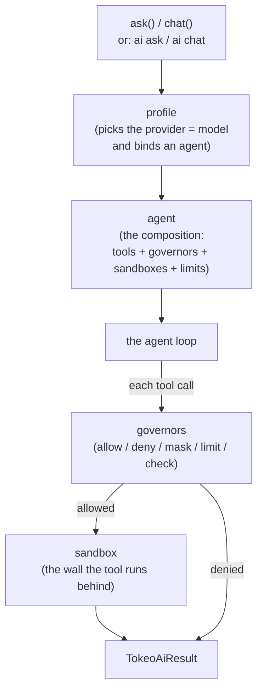
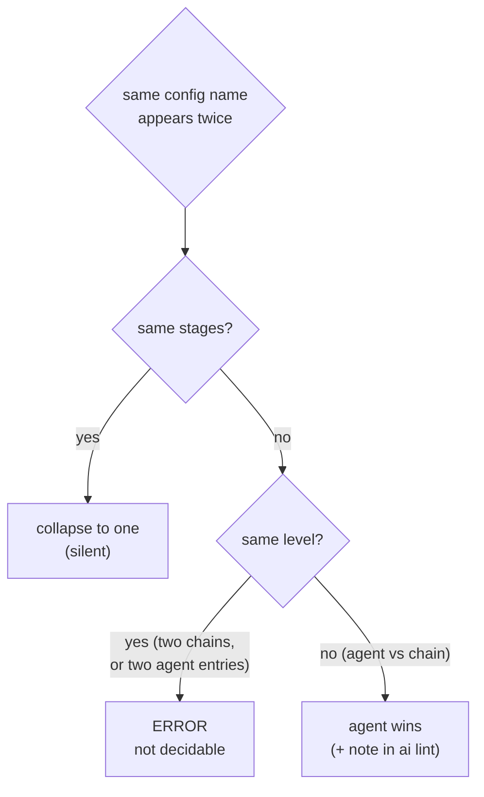
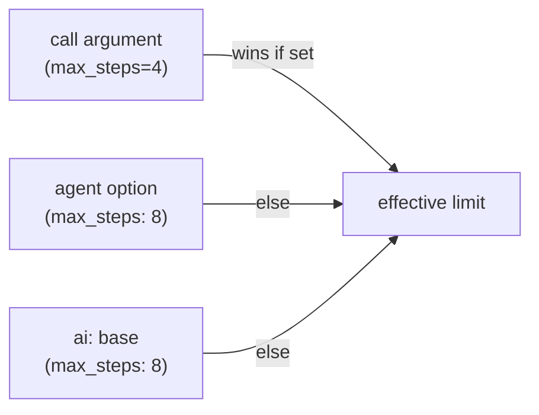

# The ```ai``` configuration

This is the reference for the ```ai:``` section of a tokeo application's
configuration: every section, every notation, and how a call tunes a run. The
resolvers that read it live next to this file (```tokeo/core/ai/config/```), one per
component kind; this document describes the shapes they accept.

All examples are YAML under a top-level ```ai:``` key. Where a value reads
```module:Class```, it is a class path, the module and the class apart by a
```:```; where it reads an alias, it is a built-in registered under that name. A
path with dots only (```module.Class```) is refused with a hint to the ```:```.
Every key that takes a list (```tools```, ```governors```, ```sandboxes```,
```deny```, ```omit```, ```except```, a stage list) also takes a single value,
read as a list of one. A key the section does not know, and an option the class
does not set in its ```config_defaults```, is an error.

## 1. The shape of ```ai:```

```yaml
ai:
  license_acknowledged: true  # read LICENSE.md first and set true to prevent notice
  max_steps: 8          # base loop limit (tool rounds), 0 = unlimited
  max_loops: 3          # consecutive rounds without a successful call, 0 = unlimited
  trace: true           # record the step history (the trace)

  defaults:             # what a command uses when it names nothing
    profile: mock
    agent: null         # no default agent

  tools:                # the toolset: items and named groups
  guards:               # the per-call pipeline: items and chains
  sandboxes:            # the execution walls a tool runs behind
  agents:               # the compositions: tools + governors + sandboxes + limits
  profiles:             # model + agent bundles a run selects
```

```license_acknowledged``` is required: without the key the lint at setup stops
the start. Its value only decides whether the license notice is shown.

A run is assembled from four kinds of building block. The diagram shows how a
call flows through them.



.. important::

    The profile chooses the model and binds one agent. The agent is
    the composition root: it owns the tools, the governors, the sandbox
    chain, and the limits. A call can *narrow* what the agent offers (deny tools,
    lower limits) but never *add* to it.

## 2. The uniform item form

The sections ```tools```, ```guards```, ```transformers```, ```conductors```,
```sandboxes``` and ```agents``` share one notation for a single element, the
item:

```yaml
some_name:
  type: alias                   # a built-in, OR
  type: module.path:SomeClass   # a class path, module and class apart by ':'
  options:                      # the class's own options (its config_defaults)
    some_option: value
```

In ```tools```, ```guards```, ```transformers``` and ```conductors``` a bare
string is the short form of an item with no options:

```yaml
some_name: alias                # == { type: alias }
```

A sandbox, an agent and a profile always need more than the type (the tools a
sandbox runs, the governors of an agent, the model of a profile), so they have
no short form; ```ai lint``` reports a string there as an error with the long
form as a hint.

.. tip::

    ```type``` resolves a class; the keys under ```options``` are the class's
    ```Meta.config_defaults```, any other key is an error. The linter checks the
    *shape* and the keys, the class checks the *values* of its options.
    ```options``` may be omitted or written as ```{}```, both give an empty
    block that the linter checks; ```options: null``` is an error.

## 3. The toolset in ```tools```

A ```tools:``` entry is an item (a dict with a ```type```), its short form (a
string), or a group (a list of member names). Groups may contain groups.

```yaml
tools:
  calc:                                   # an item (class path)
    type: myapp.core.ai.tools.calc:CalcTool
  read_file:                              # an item with options
    type: myapp.core.ai.tools.read_file:ReadFileTool
    options:
      base_dir: tmp
  mathematics:                            # a group (a list of members)
    - calc
    - stats
  filesystem:
    - read_file
    - append_file
  everything:                             # a group of groups
    - mathematics
    - filesystem
```

A profile or an agent then activates a single item or a whole group by name.

.. warning::

    A group that transitively contains itself is a configuration error;
    ```ai lint``` reports it. The resolver breaks the cycle, but the lint fails the
    run.

## 4. The governor pipeline

```guards```, ```transformers```, and ```conductors``` are three 1:1 sections with
the same notation (items and chains). At load they merge into one governor
registry, so a name is unique across all three (a collision is a config error). An
agent composes them by name under ```governors:``` (see 4.3). The three roles share
the same mechanic; they differ in character (a guard secures, a transformer
reshapes, a conductor directs the run); what a governor does is determined by its
implementation. The linter enforces section purity: a ```type``` in
```transformers``` must resolve to a ```TokeoAiTransformer``` subclass, in
```conductors``` to a ```TokeoAiConductor```, in ```guards``` to a
```TokeoAiGuard```, otherwise ```class <path> can not be used as <role>```. The rest
of this section uses ```guards``` as the example;
```transformers```/```conductors``` are identical in form.


A guard acts at one or more stages of a tool call. The six stages, in order:

| Stage | When | The guard receives |
|-------|------|--------------------|
| ```on_begin``` | run start | the accumulated ```messages``` |
| ```on_prompt``` | before the model is asked | the ```messages``` about to be sent |
| ```on_answer``` | after each model answer | the round's ```ChatResult``` |
| ```on_call``` | before a tool runs | the ```Invocation``` (may deny or reshape) |
| ```on_return``` | after a tool ran | the completed ```Invocation``` (result/error) |
| ```on_close``` | run end | the final ```ChatResult``` |

### 4.1 Configuring a guard

A ```guards:``` entry is an item (a dict), its short form (a string), or a
chain (a list).

```yaml
guards:
  tool_schema_validate:           # item with options
    type: tool_schema_validate
    options:
      schema_enforce: true        # deny a malformed call (default: only flag it)
  regex_redact:                   # item with options
    type: regex_redact
    options:
      patterns: [bearer, sk-key]  # required: no built-in list
transformers:
  truncate:                       # a project transformer by class path
    type: myapp.core.ai.transformers.truncate:MyAppAiTruncateTransformer
    options:
      max_chars: 500
```

### 4.2 Per-stage options

An item may override its ```options``` for one stage, under an
```on_<stage>``` block. The stage block overlays the base ```options```:

```yaml
transformers:
  truncate:
    type: myapp.core.ai.transformers.truncate:MyAppAiTruncateTransformer
    options:
      max_chars: 2000       # the default for every stage
    on_close:
      options:
        max_chars: 200      # but shorten the final answer harder
```

### 4.3 Composing governors on an agent

An agent's ```governors:``` list is a composition: *where and in what order* its
governors (guards, transformers, conductors) run. Each entry is a bare name or a
```name: [stages]``` stage list.

```yaml
agents:
  demo:
    type: fundi
    options:
      governors:
        - trace_audit           # bare name: runs at all the class's stages
        - truncate: [on_close]  # stage list: runs at on_close only
        - regex_redact          # bare name
```

- A bare name runs the guard at every stage its class implements.
- A ```name: [stages]``` entry runs it only at the listed stages (it *replaces*,
  not adds).
- ```[_any]``` is the explicit form of the bare name: all the class's stages.

.. caution::

    An empty stage list (```name: []```, ```name:``` or ```name: null```) is an
    error. To run a guard at several stages, name them in one list:
    ```name: [on_call, on_return]```. Listing the same guard twice with different
    stages is an error (see "Union and conflict" below).

### 4.4 Chains

A list value under ```ai.guards``` is a reusable chain: a named composition an
agent (or another chain) can import by name:

```yaml
ai:
  guards:
    secure:                     # a chain
      - trace_audit
      - regex_redact: [on_call, on_return]
  agents:
    demo:
      options:
        governors:
          - secure              # imports the chain's governors in order
          - truncate: [on_close]
        omit:
          - trace_audit         # drop one guard the chain brought in
```

```omit``` is a sibling field of ```governors```; it drops a named governor from
*this* agent's composition.

### 4.5 Union and conflict (nearest wins)

When the same guard config name appears more than once, the rules are:



.. note::

    A note is shown by ```ai lint```, not during ```ask```/```chat```. An error
    stops both: the run aborts and ```ai lint``` reports it.

### 4.6 Confirming the decision with ```confirm```

The built-in guard ```confirm``` stops at the stages it takes part in and asks a
channel to confirm the decision the guards before it reached (```allow``` or
```deny``` with the reason). A channel is a function on the cement hook
```tokeo_ai_confirm``` that gets ```(app, request)``` and returns a
```TokeoAiConfirmAnswer``` or ```None```. ```ai ask``` and ```ai chat``` register
a terminal channel when they run in a terminal; an app registers its own (a web
page, a chat, a classifier, a model).

The ```TokeoAiConfirmRequest``` holds ```subject``` (the ```Invocation``` at the
tool stages, the ```ChatResult``` at ```on_answer```/```on_close```, the messages
at ```on_begin```/```on_prompt```), ```decision``` and ```reason``` of the guards,
```answer_values``` (the values an answer may have), ```stage```,
```guard_name``` (the config name), the ```userdata``` of the run and
```notes```. The
```TokeoAiConfirmAnswer``` holds ```value``` (```yes```, ```yes_run```, ```no```
or ```no_retry```), ```by```, ```who``` and ```note```:

```python
from tokeo.core.ai.guards.confirm import GOVERNOR_CONFIRM_CHANNEL_HOOK, TokeoAiConfirmAnswer


def ask_the_reviewer(app, request):
    if request.decision == 'deny':
        return TokeoAiConfirmAnswer(TokeoAiConfirmAnswer.NO, by=TokeoAiConfirmAnswer.BY_AUTO)
    return None  # the next channel or the default decides


app.hook.register(GOVERNOR_CONFIRM_CHANNEL_HOOK, ask_the_reviewer)
```

```yaml
guards:
  ask_first:
    type: confirm
    options:
      tools: [filesystem]       # the calls asked at the tool stages (all if unset)
      default: no               # no channel answers: no (or yes)
      max_retries: 5            # no_retry runs a stage again at most so often
agents:
  careful:
    type: fundi
    options:
      governors: [spam_check, {ask_first: [on_call]}]
```

The answers, each may carry a note:

| Answer | Effect |
|--------|--------|
| ```yes``` | the decision of the guards stands |
| ```yes_run``` | the same, and the same question (stage, content, decision and reason 1:1) is not asked again in this run |
| ```no``` | the decision becomes deny: ```on_call``` skips the call, ```on_return``` replaces the result, every other stage declines the run (```TokeoAiRunDeclinedError```) |
| ```no_retry``` | not like this: the note (required) goes to ```ctx.notes```, the stage runs again, its guards judge anew with the notes, and the channel is asked again |

Without an answer the option ```default``` decides: ```no``` turns every
decision into deny, ```yes``` confirms the decision of the guards.

.. important::

    A confirm turns a yes into a no, never a no into a yes, and it changes no
    config. A no of a guard turns into a yes only when a guard judges anew with
    the notes (after a ```no_retry```) and that new decision is confirmed. The
    limits of the config (what the agent offers, the deny sets, the sandbox
    chain) stand anyway: an agent can never do more than its config allows. A
    stage runs again at most ```max_retries``` times (default 5, per guard or
    per stage), then the run is declined.

Every answer says who decided, ```by``` is required: ```human``` for a person,
```auto``` for a function of the app; without an answer it is ```default```.
Every answer lands in ```result.confirmations``` and on the trace, a note also
in ```ctx.notes```. Each entry is a dict with ```stage```, ```guard_name```,
```subject_dict``` (a short form of the subject), ```previous_decision``` and
```previous_reason``` (what the guards reached), ```answer```, ```decision```
(after the confirm), ```note```, ```by```, ```who```, ```retries``` (of the stage
before this answer), ```is_recalled``` (a ```yes_run``` answered it) and ```at```
(a UTC ```datetime```, ISO-8601 in the trace export). The guards read
```ctx.notes```; a later run gets the notes by
```chat(..., notes=result.confirmations)```. Whether the model sees a note is a
guard's decision, confirm never hands it on by itself.

A declined run raises ```TokeoAiRunDeclinedError``` with ```stage```, ```reason```,
```by``` and the run so far in ```result``` (trace, counters, confirmations,
no answer). In a dramatiq actor an exception means a retry, up to
```max_retries```, and a retried run asks the confirm again. Take the decline
out of the retries in one of two ways:

```python
# the decline is expected: no retry, the message goes to the dead letters
@app.dramatiq.actor(queue_name='ai', throws=(TokeoAiRunDeclinedError,))
def summarize(document_id):
    app.ai.ask(f'summarize {document_id}')


# the decline is an outcome: the actor keeps it and ends normally
@app.dramatiq.actor(queue_name='ai')
def summarize(document_id):
    try:
        app.ai.ask(f'summarize {document_id}')
    except TokeoAiRunDeclinedError as declined:
        keep_declined(document_id, declined.stage, declined.reason, declined.result.confirmations)
```

The dramatiq guide of tokeo (```tokeo/ext/dramatiq/DRAMATIQ.md```) explains
```throws``` and the dead letters.

## 5. The execution walls in ```sandboxes```

A sandbox is the wall a tool runs behind. An agent lists an ordered chain; a
tool runs in the first sandbox whose ```tools``` contain it.

```yaml
sandboxes:
  jailed:                       # an item with a tool selection
    type: subprocess
    tools:
      - mathematics             # tool/group names this sandbox claims
    except:
      - calc                    # ... but not these (chain walks on for them)
  local:
    type: in_process
    tools:
      - calendar                # trusted, quick tools that may run in process
```

```yaml
agents:
  demo:
    options:
      sandboxes:
        - jailed                # tried first
        - local                 # then this one
```

.. important::

    There is no catch-all. A sandbox runs only the tools and groups its
    ```tools``` names, a single name counts as a list of one. When no sandbox
    in the chain names a tool, the call is denied, so a new tool runs nowhere
    until a sandbox names it.

There are four types. Each offers only the options it can keep: a key a type
does not know is a lint error, so no config promises a limit that does not
hold. The tables below are the complete options of each type with their
defaults; a value outside the allowed range is a lint error too.

| Type | ```type``` | What it is |
|---|---|---|
| in process | ```in_process``` | the app process itself, no wall |
| subprocess | ```subprocess``` | a fresh interpreter, a process group of its own |
| docker | ```docker``` | a hardened, throwaway container of the app's image |
| wasm | ```tokeo.core.ai.sandboxes:TokeoAiWasmSandbox``` | a WebAssembly guest under Wasmtime (extra ```tokeo-fundi[wasm]```) |

### 5.1 What each sandbox can enforce

"yes" means the host or the kernel enforces the limit; the tool cannot get
around it.

| Limit | ```in_process``` | ```subprocess``` | ```docker``` | wasm |
|---|---|---|---|---|
| run time (```timeout```) | no | yes, SIGKILL to the group | yes, the container is killed | yes, a timer stops the guest |
| memory (```max_memory_mb```) | no | yes, rlimit (macos rejects small limits) | yes, cgroup | yes, store limits |
| processes (```max_pids```) | no | no, all end with the call | yes | no processes |
| disk (```max_disk_mb```) | no | no | yes, the tmpfs ```/tmp``` with ```read_only``` | yes, ```/io```, ```/work```, stdout and stderr |
| files (```max_files```) | no | no | no | yes |
| network | no | no | yes, ```network: none``` | yes, there is none |
| visible files (```mounts```) | all | all | only the mounts, read-only | only the mounts and ```cwd``` |
| environment (```env```) | the app's | only ```env``` | only ```env``` | only ```env``` |
| output (```max_output_mb```) | yes | yes | yes | yes |

```max_output_mb``` limits two things in every sandbox. The captured stdout and
stderr of a tool keep their first ```max_output_mb``` each and end with a mark
```[... cut after 1 MB]```; they are hints, so a cut is no error. The reply the
host reads (the value) is read up to ```max_output_mb``` only; a larger reply is an
error ```tool ... delivered more than 1 MB```. So a tool cannot fill the memory
of the host, whatever it prints or returns.

.. note::

    In ```subprocess``` and ```docker``` a tool that writes past its capture
    straight to the file descriptor 1 still grows a temporary file on the host
    disk; the host reads only ```max_output_mb``` of it. Where the disk must be
    safe from the tool, use the wasm sandbox (```max_disk_mb```).

### 5.2 ```in_process```

The call runs in the app process: full access to the app, no overhead, no
wall. Name only trusted, quick tools here.

| Option | Default | Values | Enforced by |
|---|---|---|---|
| ```max_output_mb``` | ```1``` | a number above 0 | the capture buffer |

```yaml
sandboxes:
  local:
    type: in_process
    tools: [calendar]
    options:
      max_output_mb: 1          # stdout and stderr kept per call
```

### 5.3 ```subprocess```

The call runs in a fresh interpreter with the generic runner, in a process
group of its own; the group ends with the call. It contains a crash or a
runaway, it is no jail: the tool can read files and reach the network.

| Option | Default | Values | Enforced by |
|---|---|---|---|
| ```timeout``` | ```null``` | seconds, ```null``` = no limit | the host, SIGKILL to the group |
| ```max_memory_mb``` | ```null``` | MB, ```null``` = no limit | the kernel, rlimit (RLIMIT_AS, else RLIMIT_DATA); macos rejects small limits, the call then fails |
| ```cwd``` | ```null``` | a directory, created on demand | nothing, it steers relative paths |
| ```env``` | ```null``` | ```{NAME: value}```, ```${NAME}``` expands | the host, nothing else is set |
| ```max_output_mb``` | ```1``` | a number above 0 | the runner (capture), the host (reply) |

```yaml
sandboxes:
  jailed:
    type: subprocess
    tools: [mathematics]
    options:
      timeout: 10               # seconds, then the group is killed
      max_memory_mb: 256        # rlimit (linux; macos rejects small limits)
      cwd: tmp/sandbox          # working dir for relative paths
      env:                      # only these variables, ${NAME} expands
        TZ: ${TZ}
      max_output_mb: 1          # stdout and stderr kept, largest reply
```

### 5.4 ```docker```

The call runs in a throwaway container of ```image```; the image must hold
tokeo, fundi and the tools of the app, the image of the app itself is the
simplest choice. ```--rm```, ```--cap-drop ALL``` and
```--security-opt no-new-privileges``` are always set, every mount is
read-only. Several docker sandboxes may differ in their rights.

| Option | Default | Values | Enforced by |
|---|---|---|---|
| ```image``` | ```null``` | required, an image name | the client |
| ```command``` | ```docker``` | ```docker``` or ```podman``` | the client |
| ```python``` | ```python3``` | the interpreter in the image | the client |
| ```network``` | ```none``` | a docker network, ```none``` = no network | docker |
| ```read_only``` | ```true``` | ```true```, ```false``` | docker |
| ```max_disk_mb``` | ```64``` | a whole number from 1, the tmpfs ```/tmp``` (with ```read_only```) | docker |
| ```max_memory_mb``` | ```512``` | MB, ```0``` = no limit | docker, cgroup |
| ```max_pids``` | ```128``` | processes, ```0``` = no limit | docker |
| ```user``` | ```65534:65534``` | ```uid:gid```, never root (lint error) | docker |
| ```mounts``` | ```null``` | ```{guest_path: host_path}```, read-only | docker |
| ```env``` | ```null``` | ```{NAME: value}```, ```${NAME}``` expands | docker, nothing else is set |
| ```timeout``` | ```30``` | seconds | the host, then the container is killed |
| ```reuse``` | ```false``` | ```true``` = one container for the process | the host |
| ```max_output_mb``` | ```1``` | a number above 0 | the runner (capture), the host (reply) |

```yaml
sandboxes:
  docked:
    type: docker
    tools: [mathematics]
    options:
      image: myapp:latest       # required
      command: docker           # or podman (rootless)
      network: none             # a docker network, none = no network
      read_only: true           # read-only root, a tmpfs /tmp
      max_disk_mb: 64           # size of /tmp
      max_memory_mb: 512        # memory limit, 0 = none
      max_pids: 128             # process limit, 0 = none
      user: '65534:65534'       # never root
      mounts:                   # guest path: host path, read-only
        /data: ./data
      env:                      # only these variables, ${NAME} expands
        TZ: ${TZ}
      timeout: 30               # seconds, then the container is killed
      reuse: false              # true = one container for the process
      max_output_mb: 1          # stdout and stderr kept, largest reply
```

.. warning::

    Whoever may use the docker service is root on the host in effect. Run the
    app with docker rights only where that is acceptable, prefer rootless
    podman, and never mount the docker socket into a container of the app.

With ```read_only: false``` the container writes to its own layer on the host
disk and ```max_disk_mb``` has no effect; keep ```read_only``` where the disk
matters.

### 5.5 wasm

The call runs in a WebAssembly guest under Wasmtime: no network, only the
mounts are visible, the same limits on every platform. It needs the extra
```tokeo-fundi[wasm]``` and a CPython-WASI build; how to build one and how the
guest works is in the guide ```WASM.md``` of the sandboxes.

| Option | Default | Values | Enforced by |
|---|---|---|---|
| ```runtime``` | ```null``` | required, path to ```python.wasm``` | the host |
| ```stdlib``` | ```null``` | required, path to its stdlib, read-only at ```/lib``` | the host |
| ```mounts``` | ```null``` | ```{guest_path: host_path}```, read-only | the host |
| ```cwd``` | ```null``` | a host directory, read-write at ```/work``` | the host |
| ```env``` | ```null``` | ```{NAME: value}```, ```${NAME}``` expands | the host, nothing else is set |
| ```timeout``` | ```null``` | seconds, ```null``` = no limit | the host, a timer at the epoch |
| ```max_memory_mb``` | ```null``` | MB, ```null``` = no limit | Wasmtime, store limits |
| ```max_disk_mb``` | ```64``` | MB the guest adds to ```/io```, ```/work```, stdout and stderr; ```null``` = no limit | the host, the watcher |
| ```max_files``` | ```1000``` | files and dirs the guest adds to ```/io``` and ```/work```; ```null``` = no limit | the host, the watcher |
| ```watch_interval``` | ```1.0``` | seconds between two checks of ```max_disk_mb``` and ```max_files```, at least ```0.1``` | the host |
| ```cache``` | ```null``` | a directory only the operator can write | the host |
| ```shim_wasi_stdlib``` | ```true``` | ```true```, ```false``` | the host, trusted path only |
| ```max_output_mb``` | ```1``` | a number above 0 | the host |

```yaml
sandboxes:
  coded:
    type: tokeo.core.ai.sandboxes:TokeoAiWasmSandbox
    tools: [coding]
    options:
      runtime: ./wasm/python.wasm
      stdlib: ./wasm/lib/python3.13
      max_memory_mb: 256        # hard limit, the same on every platform
      timeout: 10               # seconds
      max_disk_mb: 64           # what the guest may write
      max_files: 1000           # what the guest may create
      watch_interval: 1.0       # seconds between the disk and file checks
      max_output_mb: 1          # stdout and stderr kept, largest value
```

## 6. The compositions in ```agents```

An agent is the composition root a profile binds. It is an item (```type: fundi```
is the standard agent) whose ```options``` assemble the run: which tools, which
guard pipeline, which sandbox chain, and the limits.

```yaml
agents:
  guarded:
    type: fundi
    options:
      tools:                    # the tools this agent contributes
        - mathematics
        - filesystem
      governors:                # the pipeline (a composition, see the governors sections)
        - secure                # a chain (brings trace_audit + regex_redact)
        - truncate: [on_close]
      sandboxes:                # the chain (see the sandboxes section)
        - jailed
        - local
      deny:                     # a hard ban, before any sandbox lookup
        - append_file
      omit:                     # drop a guard the chain brought in (see chains)
        - regex_redact
      max_steps: 8              # per-agent limit override (nearest wins)
      max_loops: 3
```

| Option | Meaning |
|--------|---------|
| ```tools``` | the tools/groups this agent contributes (the active set of a call) |
| ```governors``` | the governor composition (guards + transformers + conductors) |
| ```sandboxes``` | the ordered sandbox chain (the sandboxes section) |
| ```deny``` | tools/groups forbidden outright, before any sandbox lookup |
| ```omit``` | governor config names to drop from the composition (chains) |
| ```max_steps``` / ```max_loops``` | per-agent limit overrides (nearest wins) |

.. note::

    ```deny``` is a hard ban (the tool never runs); a sandbox ```except``` only
    skips *that* sandbox and lets the chain walk on. They are different mechanisms.

## 7. Model and agent bundles in ```profiles```

A profile names a provider (by ```type```) and a model, and binds an agent. A
run selects one profile by name, by ```purpose```, by ```model```, or the default.

```yaml
profiles:
  mock:                         # the built-in local model
    type: mock
    purpose: mocking            # optional free-form selector
    agent: guarded              # the composition this profile runs

  assistant:
    type: oai_compat            # any OpenAI-compatible server
    model: "llama-3.1-8b"
    agent: guarded
    options:                    # the provider's connection
      base_url: http://localhost:8000/v1
      timeout: 120
      # key: ${OPENAI_API_KEY}  # via config resolution, not clear text
```

Every key has exactly one place:

| Key | Place | Meaning |
|-----|-------|---------|
| ```type``` | top | the provider, an alias or ```module:Class``` |
| ```purpose``` | top | a free-form selector |
| ```agent``` | top | the agent the profile runs, or ```null``` |
| ```deny``` | top | tools or groups this profile drops (7.1) |
| ```enabled``` | top | ```false``` hides the profile, also from its name |
| ```model``` | top | the model the provider asks for, also a selector |
| ```model_params``` | top | passed through to the server, see 8 |
| ```base_url```, ```key```, ```timeout``` | ```options``` | the connection of ```oai_compat``` |

The keys under ```options``` are the provider's ```Meta.config_defaults```; a
provider of your own sets its own there. Any other key, at the top or under
```options```, is an error.

.. important::

    The agent of a run resolves in this order: the call (```--agent``` or
    ```agent=```), then the profile's ```agent```, then ```ai.defaults.agent```.
    A profile without the key ```agent``` falls through to the default; a
    profile with ```agent: null``` runs with no agent on purpose, also when a
    default is set. A call that names an agent wins over both.

    There is always an agent: where none results, the run gets the implicit
    agent ```__implicit```: no tools, no sandboxes, no governors, the ai-level
    limits. It exists only for a quick ```ask``` or ```chat``` without any
    agent; it shows in the trace, but no call, command or config can name it.
    Names starting with ```__``` are reserved for the framework.

### 7.1 Carving out a subset with ```deny```

A profile may ```deny``` tools or groups, to run a shared agent with a smaller
toolset. The active tools are ```agent.tools``` minus ```agent.deny``` minus
```profile.deny```:

```yaml
profiles:
  calendar_only:
    type: mock
    agent: guarded              # a rich agent ...
    deny:
      - mathematics             # ... but this profile drops these groups
      - filesystem
```

## 8. Tuning the model by provider parameters

The ```oai_compat``` provider passes a ```model_params``` block straight through to
the endpoint. These steer *how* the model answers. ```model_params``` is not
checked, it is passed through: the linter only demands a mapping, the endpoint
owns the valid keys and ranges, which vary by model.

```yaml
profiles:
  assistant:
    type: oai_compat
    model: "llama-3.1-8b"
    options:
      base_url: http://localhost:8000/v1
    model_params:
      temperature: 0.2          # randomness, ~0.0-2.0 (lower = more focused)
      top_p: 0.9                # nucleus sampling cutoff, 0.0-1.0
      max_tokens: 1024          # limit of the answer length
      frequency_penalty: 0.0    # damp repetition, ~-2.0-2.0
      presence_penalty: 0.0
      stop: ["\n\n"]            # string or list that ends generation
      seed: 42                  # fixed value for (mostly) reproducible output
      response_format:          # e.g. structured JSON output
        type: json_object
```

Common keys and what they do:

| Key | Effect |
|-----|--------|
| ```temperature``` | randomness / creativity (lower = more focused, deterministic) |
| ```top_p``` | nucleus sampling cutoff |
| ```max_tokens``` | hard limit of the generated answer length |
| ```frequency_penalty``` / ```presence_penalty``` | damp repetition |
| ```stop``` | string or list that ends generation |
| ```seed``` | fixed value for (mostly) reproducible output |
| ```response_format``` | request a shape, e.g. ```{type: json_object}``` |
| ```tool_choice``` | ```auto``` / ```none``` / ```required```, or a named function |
| ```model``` | override the profile's model for that call only |

### 8.1 Overriding parameters per call (CLI)

```ai ask``` and ```ai chat``` take repeatable ```--model-param key=value``` flags
that override the profile's ```model_params``` for that one call. The value is
coerced like a YAML scalar; ```key=null``` *removes* a key, falling back to the
profile's value.

```bash
# more focused for one question
myapp ai ask "summarise this" --model-param temperature=0.1

# several at once
myapp ai ask "be creative" --model-param temperature=1.2 --model-param top_p=0.95

# drop a profile-set key for this call
myapp ai ask "..." --model-param seed=null
```

## 9. Using the loop from your own code

```ask()``` and ```chat()``` are the programmatic entry points on the ```ai```
handler (```app.ai```). They take the same selectors as the CLI, so your application
logic can tune a run at the call site.

### 9.1 One prompt and its reply text with ```ask```

```python
text = app.ai.ask(
    'weekday of 2026-12-24',
    profile='assistant',        # or model=/purpose= to select a profile
    agent='guarded',            # select the agent (composition)
    model_params={'temperature': 0.1},
    deny=['filesystem'],        # narrow the toolset for this call
    userdata={'request_id': 42},
)
# -> str: the assistant text
```

A run a governor declined raises ```TokeoAiRunDeclinedError``` (stage, reason,
by, and the run so far in ```result```), from ```ask``` as from ```chat```.

### 9.2 Full control and the full result with ```chat```

```chat()``` takes a ```messages``` list and returns the whole ```TokeoAiResult```:

```python
result = app.ai.chat(
    messages=[{'role': 'user', 'content': 'calc 2 + 3'}],
    profile='assistant',
    agent='guarded',
    model_params={'temperature': 0.2, 'max_tokens': 512},
    deny=['append_file'],
    max_steps=4,                # lower the limit for this call
    max_loops=2,
    userdata={'tenant': 'acme'},
)

result.answer      # the model's ChatResult (result.answer.text is the text)
result.trace       # the ordered step history (empty if ai.trace is false)
result.loopdata    # the run's loop counters
result.confirmations  # every confirm decision of the run, in order
```

A declined run does not return, it raises ```TokeoAiRunDeclinedError```:

```python
try:
    result = app.ai.chat(messages=[{'role': 'user', 'content': 'append_file hello'}], agent='careful')
except TokeoAiRunDeclinedError as declined:
    declined.stage, declined.reason, declined.by  # where, why, and who decided
    declined.result.trace                         # the run so far, no answer
```

The call arguments and where each is resolved:

| Argument | Purpose | Resolution |
|----------|---------|------------|
| ```profile``` / ```model``` / ```purpose``` | select the profile (the model) | one of them, or ```ai.defaults.profile``` |
| ```agent``` | select the composition | the arg, else profile's agent, else ```ai.defaults.agent``` |
| ```deny``` | narrow the toolset | added to agent + profile deny |
| ```model_params``` | per-call model tuning | overlays the profile's ```model_params``` |
| ```max_steps``` / ```max_loops``` | per-call limits | nearest wins: call → agent → ```ai:``` base |
| ```turndata``` | starting values for the run's turndata | taken 1:1 into ```ctx.turndata``` |
| ```userdata``` | your own context, carried through | untouched by the framework |
| ```notes``` | notes of confirm answers from earlier runs | read by the guards as ```ctx.notes``` |

### 9.3 Limits resolve nearest-wins



### 9.4 Carrying your own context in ```userdata```

```userdata``` is an opaque value tokeo carries on the run context and never
touches. A custom guard or tool reads it back to reach your application's own
context: a tenant id, a request id, a permissions handle.

```python
result = app.ai.chat(messages, agent='guarded', userdata={'tenant': 'acme'})
```

```python
# inside a custom guard
from tokeo.core.ai import Invocation
from tokeo.core.ai.guards.policy import TokeoAiPolicyGuard


class MyGuard(TokeoAiPolicyGuard):
    def on_call(self, ctx, invocation):
        tenant = (ctx.userdata or {}).get('tenant')
        # decide based on your own context
        if tenant != 'acme':
            invocation.decision = Invocation.DENY
            invocation.reason = f'tenant {tenant!r} may not call {invocation.name}'
```

.. note::

    ```userdata``` content is entirely the caller's concern; the framework
    guarantees only that it arrives unchanged on ```ctx.userdata```.

## 10. Validating the configuration

```ai lint``` checks the whole ```ai:``` section: unknown keys, unknown options
(every key under ```options``` is one of the class's ```Meta.config_defaults```),
unknown references, malformed items, unknown stages, empty stage lists, group
cycles, and the guard conflicts. A key nobody reads is never silently ignored.

The same lint runs once when ```app.ai``` is set up, on every path (a command,
a worker, a web app, your own code): an error ends the start with the report, a
warning goes to the log. It runs after the project's own ```post_setup```
hooks, so an alias registered there with ```app.ai.register``` is known. Only
```ai lint``` and ```--help``` start with a broken configuration, so the report
and the help stay reachable.

```bash
myapp ai lint              # reports errors, warnings, and notes
myapp ai lint --strict     # treat warnings as failures too
```

| Level | Meaning | Stops a run? |
|-------|---------|---------------|
| ```error``` | the config cannot resolve as written, or holds a key nobody reads | yes |
| ```warning``` | a gap worth closing (no defaults) | no; ```ai lint --strict``` fails on it |
| ```note``` | a resolved-but-worth-pointing-out fact (e.g. agent over chain) | no |

.. tip::

    Lint after every config change. A note about an agent overriding a chain is
    often the first sign that a composition does not do what you expected.
